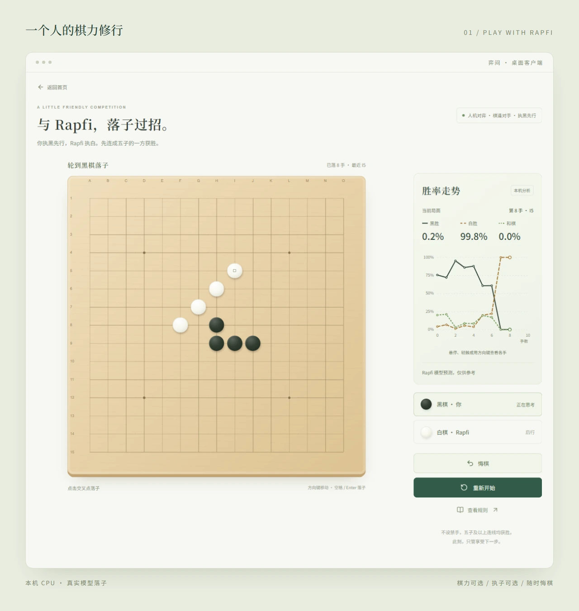
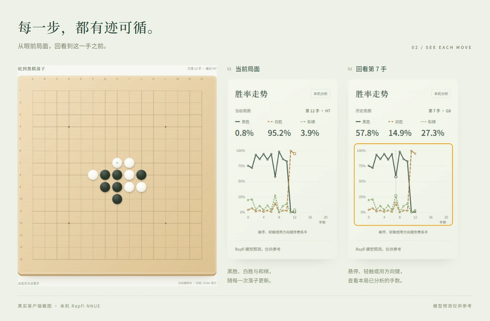
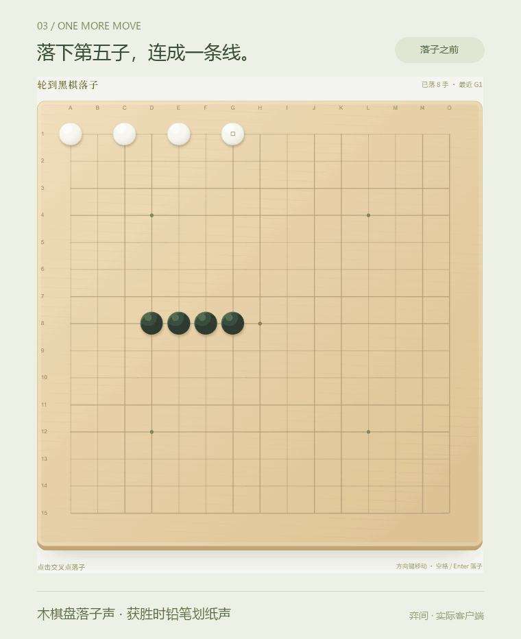
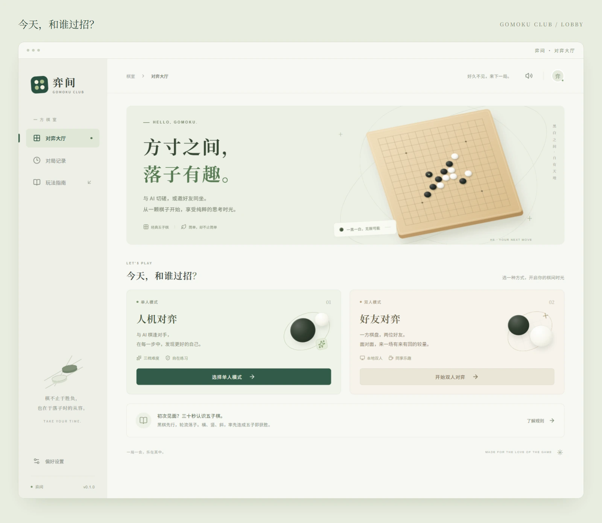
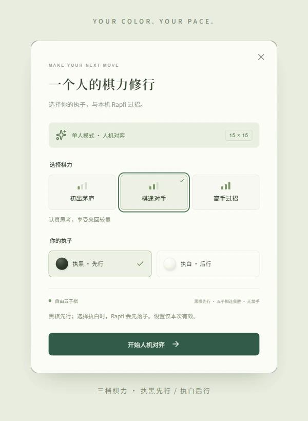

<div align="center">


# 弈间 · Gomoku Club

**与 AI 切磋，或邀好友同坐。**

一款在本机运行的五子棋桌面应用。木色棋盘、黑白落子，把时间留给下一步。

[快速开始](#快速开始) · [功能预览](#功能预览) · [开发文档](docs/development.md) · [参与贡献](CONTRIBUTING.md)


</div>

---

## 一方棋盘，两种陪伴

| 一个人，慢慢练                                          | 两个人，面对面                             | 每一步，看得见                                       |
| ------------------------------------------------------- | ------------------------------------------ | ---------------------------------------------------- |
| 与本机 Rapfi 对弈，选择执黑或执白，用三档棋力调整挑战。 | 共用一台电脑，黑白轮流，点击棋盘就能开始。 | 黑胜、白胜、和棋概率随落子更新，沿曲线回看本局变化。 |

不需要账号，也不需要 API Key。引擎准备完成后，对弈和分析都在自己的电脑上运行。

## 功能预览

### 与 Rapfi，落子过招

选择「初出茅庐」「棋逢对手」或「高手过招」，再决定先行还是后手。你落一子，Rapfi 在本机思考应对；想换一种走法，悔棋会撤回到你上一手之前。



三档棋力对应不同的搜索时间与深度，不代表固定的人类段位。选择执白时，Rapfi 会自动开局。

### 局面的起伏，不只靠感觉

每次落子后，黑胜、白胜与和棋的模型预测都会画进曲线。悬停、轻触，或用方向键查看之前的手数；悔棋后裁剪旧分支，重新开始时清空。



概率来自本机 Rapfi NNUE 模型，作为局面参考；未完成分析的手数保留缺口。终局结果由五子棋规则确定。

### 让一盘棋，有一点手感

棋子落下，是轻敲木棋盘的声音。五子相连时，连线随着铅笔划纸声画出；还想再想一步，按下「悔棋」就能继续。

<p align="center">
  
</p>

动图无声，音效请在客户端体验。音效可以统一关闭，动画遵循系统的「减少动态效果」设置。

<details>
<summary><strong>再看看对弈大厅和执子设置</strong></summary>

<p align="center">
  
</p>
<p align="center">
  
</p>

</details>

所有界面图均来自当前 Electron 客户端，分析数据由实际加载的本机模型生成；封面与图文排版为项目原创。见 [图片说明](docs/assets/readme/README.md)。

## 快速开始

当前提供**从源码运行的桌面版本**，支持 Windows x64 与 Apple Silicon Mac，尚未提供安装包。macOS 支持尚未在真机上完成验证，遇到问题欢迎反馈。

### 环境要求

| 环境         | 要求                                                                                                                                 |
| ------------ | ------------------------------------------------------------------------------------------------------------------------------------ |
| 系统         | Windows x64（CPU 支持 SSE4.1），或 Apple Silicon Mac（macOS 14+）；无需独立显卡、CUDA 或 Python                                      |
| Node.js      | 22.12+，或 24+（项目本地使用 Node 24）                                                                                               |
| Java         | JDK 17+，确保 `java` 与 `javac` 可用                                                                                                 |
| Maven        | 3.9+，确保 `mvn` 可用                                                                                                                |
| 引擎准备工具 | Windows：系统自带的 PowerShell、`tar.exe` 与 .NET Framework 4.x 的 Framework64 `csc.exe`；macOS：系统自带的 `curl`、`tar` 与 `xattr` |

```powershell
git clone https://github.com/Felix-cy110/Gomoku-ai.git
cd Gomoku-ai
npm install
npm run dev
```

启动命令会准备 Rapfi 引擎与模型、构建 Java 服务，并打开桌面窗口。首次需要联网下载约 35 MB 的官方引擎包，后续复用经过校验的缓存；运行时不访问模型服务器。

打开后，选择「单人模式」与 Rapfi 对弈，或点击「开始双人对弈」与身边的朋友下棋。

<details>
<summary><strong>浏览器预览与本地生产构建</strong></summary>

仅预览网页和体验本地双人棋局：

```powershell
npm run dev:web
```

访问 `http://127.0.0.1:5187`。网页预览不支持本机 Rapfi 分析或人机落子。

构建并启动本地生产版本：

```powershell
npm run build
npm start
```

当前没有内置 JRE，仍需本机 Java 环境。端口调整、后端单独开发和验证命令见 [开发与验证](docs/development.md)。

</details>

## 使用前了解一下

- **规则**：15 × 15 自由五子棋，黑棋先行，不设禁手，连续五子及以上获胜；满盘无人获胜则和棋。
- **悔棋**：双人模式每次撤回一手；单人模式撤回到玩家上一手之前，执白时保留模型的开局棋子。终局后也可悔棋继续。
- **本地运行**：不需要登录，不使用云端模型服务。浏览器可双人对弈，本机 AI 功能需要 Windows x64 或 Apple Silicon Mac 上的桌面客户端。
- **当前范围**：尚未实现对局记录和棋谱保存，也不持久化用户设置。刷新、返回首页或关闭应用会结束本局；刷新或重启后恢复普通难度、执黑和音效开启。

## 面向开发者

**Electron · React · TypeScript · Spring Boot 3.5.11 · Java 17 · Rapfi NNUE**

React 负责界面，TypeScript 处理棋局规则，Electron 管理本机引擎，Spring Boot 提供健康检查。渲染进程通过受限 IPC 调用分析能力，不直接访问 Node.js。

| 文档                                   | 内容                                              |
| -------------------------------------- | ------------------------------------------------- |
| [开发与验证](docs/development.md)      | 环境准备、启动命令、端口配置、构建和测试          |
| [架构与数据边界](docs/architecture.md) | 模块职责、Spring Boot 分层、API 与内存状态约定    |
| [本地 Rapfi 分析](docs/rapfi.md)       | 引擎与权重、搜索强度、协议、资源准备及进程回收    |
| [代码编写规范](AGENT.md)               | 解耦、枚举、命名、测试及中文 Conventional Commits |

## 参与贡献

欢迎带来一份反馈、一段代码，或一个更好的下棋体验。

[报告问题](https://github.com/Felix-cy110/Gomoku-ai/issues/new?template=bug_report.yml) · [提出建议](https://github.com/Felix-cy110/Gomoku-ai/issues/new?template=feature_request.yml) · [贡献指南](CONTRIBUTING.md)

项目由 [Felix Sun（@Felix-cy110）](https://github.com/Felix-cy110) 创建与维护。感谢每一位参与者，署名见 [贡献者名单](CONTRIBUTORS.md)，代码贡献见 [GitHub Contributors](https://github.com/Felix-cy110/Gomoku-ai/graphs/contributors)。

## 许可证与致谢

本项目采用 [MIT License](LICENSE)。Rapfi 引擎、模型、字体等第三方资源遵循各自的许可证，详情见 [第三方说明](THIRD_PARTY_NOTICES.md)。

---

<p align="center">一局一会，乐在其中。<br /><sub>MADE FOR THE LOVE OF THE GAME</sub></p>
