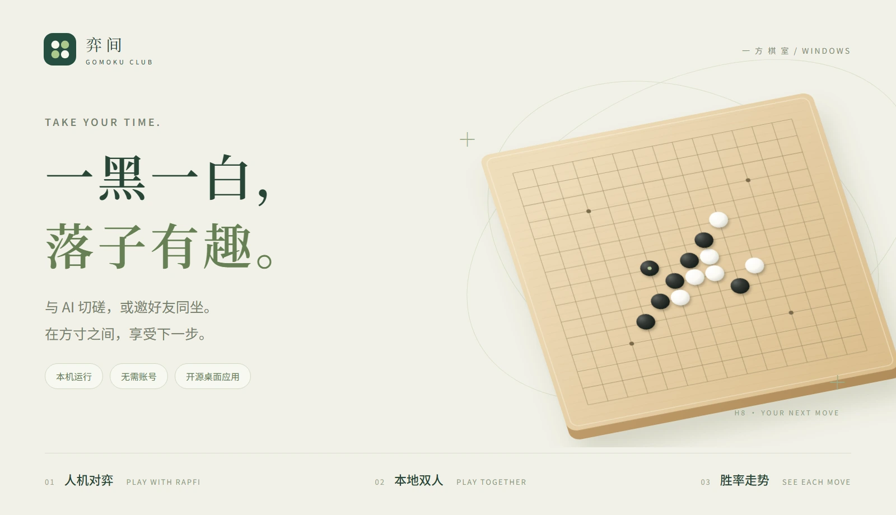
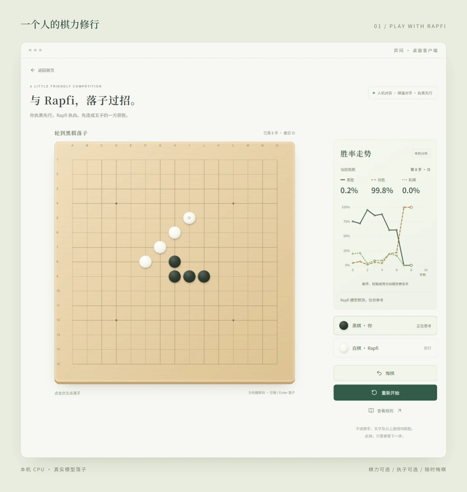
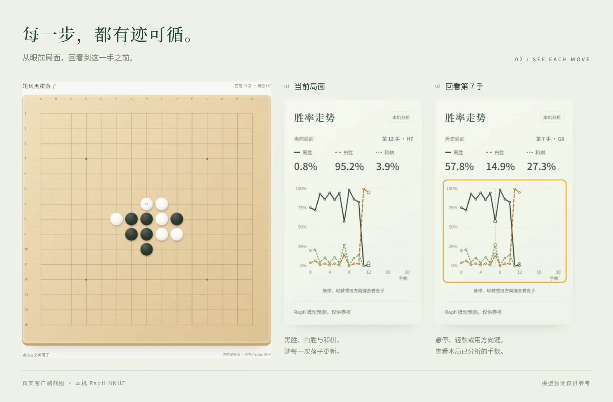
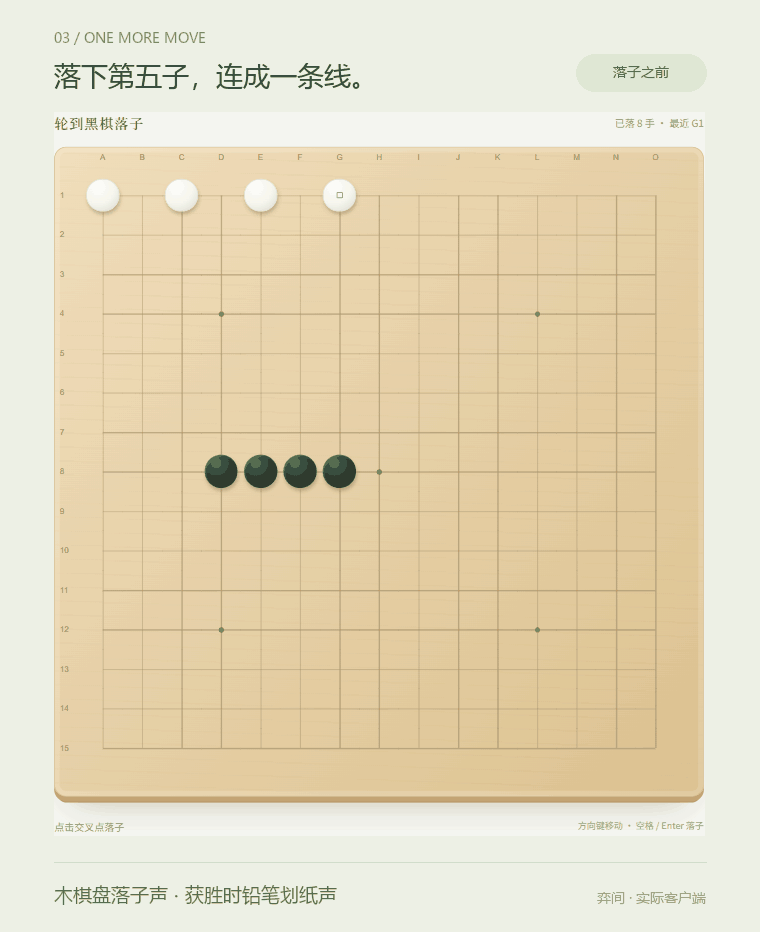
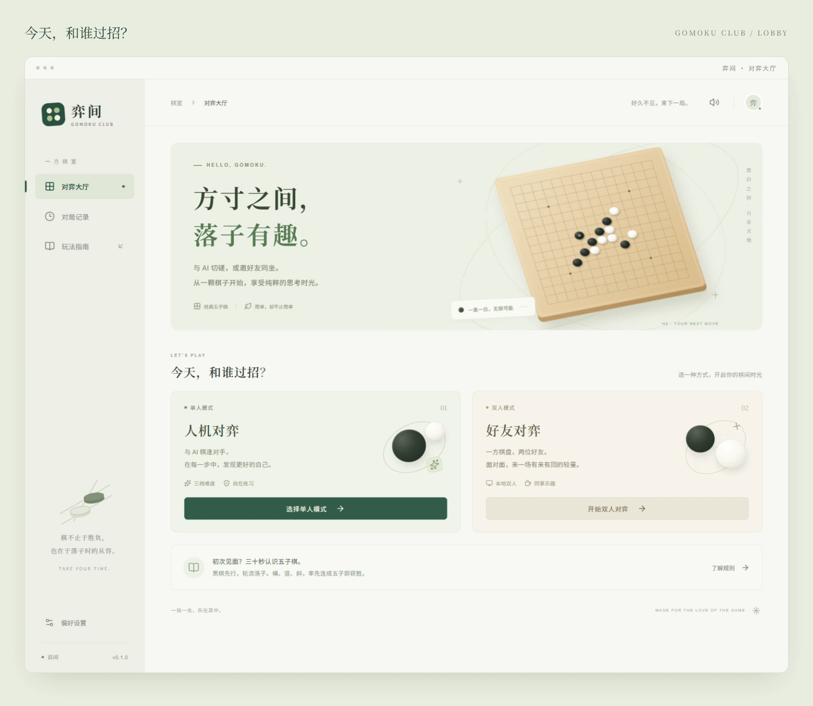
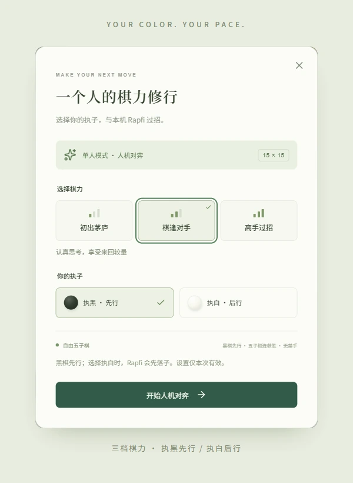

<p align="right">
  <strong>English</strong> | <a href="README.zh-CN.md">简体中文</a>
</p>

<div align="center">



# Gomoku Club

**Challenge AI, or share the board with a friend.**

A local-first desktop Gomoku app with a wooden board, black and white stones, and room to think about your next move.

[Quick Start](#quick-start) · [Feature Tour](#feature-tour) · [Developer Docs](docs/development.md) · [Contributing](CONTRIBUTING.md)


</div>

---

## One Board, More Ways to Play

| Practice at your own pace                                      | Play face-to-face                                      | See every turn take shape                                      |
| -------------------------------------------------------------- | ------------------------------------------------------ | -------------------------------------------------------------- |
| Face the local Rapfi engine, choose your side, and pick a level. | Share one computer and take turns placing black and white stones. | Follow black-win, white-win, and draw probabilities as the game unfolds. |

No account or API key is required. Once the engine is ready, gameplay and analysis both run on your own computer.

## Feature Tour

### Play against Rapfi

Choose Easy, Normal, or Hard, then decide whether to move first or second. After you place a stone, Rapfi thinks locally and responds. If you want to try another line, Undo returns the game to the point before your previous turn.



The three levels use different search times and depths; they do not represent fixed human ranks. When you choose white, Rapfi opens the game automatically.

### Read the position, move by move

After every move, the model's black-win, white-win, and draw predictions are added to the chart. Hover, tap, or use the arrow keys to inspect earlier moves. Undo trims the abandoned branch, and restarting clears the history.



The probabilities come from the local Rapfi NNUE model and are provided as position guidance. Moves whose analysis has not finished remain blank. Final results are determined by the Gomoku rules.

### Give every move some weight

A placed stone taps softly against the wooden board. When five connect, the winning line is drawn to the sound of pencil on paper. If you want one more chance to think, press Undo and continue.

<p align="center">
  
</p>

The GIF is silent; try the client to hear the game sounds. Audio can be muted globally, and animations respect the system's reduced-motion setting.

<details>
<summary><strong>See the game lobby and side selection</strong></summary>

<p align="center">
  
</p>
<p align="center">
  
</p>

</details>

Every interface image comes from the current Electron client, and the analysis data was generated by the locally loaded model. The cover and editorial layout are original to this project. See the [image notes](docs/assets/readme/README.md).

## Quick Start

The project currently provides a **desktop version that runs from source** on Windows x64 and Apple Silicon Mac. Installers are not available yet. macOS support has not yet been verified on physical hardware, so issue reports are welcome.

### Requirements

| Environment         | Requirement                                                                                                                                                     |
| ------------------- | --------------------------------------------------------------------------------------------------------------------------------------------------------------- |
| Operating system    | Windows x64 with an SSE4.1-capable CPU, or Apple Silicon Mac with macOS 14+; no discrete GPU, CUDA, or Python required                                          |
| Node.js             | 22.12+, or 24+; the project is developed locally with Node 24                                                                                                   |
| Java                | JDK 17+ with both `java` and `javac` available                                                                                                                   |
| Maven               | 3.9+ with `mvn` available                                                                                                                                        |
| Engine setup tools  | Windows: built-in PowerShell, `tar.exe`, and the Framework64 `csc.exe` from .NET Framework 4.x; macOS: built-in `curl`, `tar`, and `xattr`                      |

```powershell
git clone https://github.com/Felix-cy110/Gomoku-ai.git
cd Gomoku-ai
npm install
npm run dev
```

The startup command prepares the Rapfi engine and model, builds the Java service, and opens the desktop window. The first run downloads an official engine package of about 35 MB; later runs reuse a verified cache. The app does not contact a model server during play.

Once the app opens, choose Solo Play to challenge Rapfi or start a two-player game with someone beside you.

<details>
<summary><strong>Browser preview and local production build</strong></summary>

To preview the web interface and play a local two-player game:

```powershell
npm run dev:web
```

Open `http://127.0.0.1:5187`. The browser preview does not support local Rapfi analysis or AI moves.

To build and start the local production version:

```powershell
npm run build
npm start
```

The app does not bundle a JRE, so Java must still be installed locally. See [Development and Verification](docs/development.md) for port configuration, standalone backend development, and verification commands.

</details>

## Before You Play

- **Rules:** 15 × 15 freestyle Gomoku. Black moves first, there are no forbidden moves, and five or more consecutive stones win. A full board without a winner is a draw.
- **Undo:** Two-player mode removes one move at a time. Solo mode returns to the point before the player's previous turn; when the player is white, Rapfi's opening stone remains. You can also undo after the game ends and continue playing.
- **Local operation:** No login or cloud model service is used. The browser supports two-player games, while local AI features require the desktop client on Windows x64 or Apple Silicon Mac.
- **Current scope:** Match history and game-record export are not implemented, and user settings are not persisted. Refreshing, returning home, or closing the app ends the current game. After a refresh or restart, the app returns to Normal difficulty, black stones, and enabled audio.

## For Developers

**Electron · React · TypeScript · Spring Boot 3.5.11 · Java 17 · Rapfi NNUE**

The frontend uses React, TypeScript, Tailwind CSS, Rsbuild, and i18next. Players can switch between Simplified Chinese and English from the top bar without interrupting the game or its analysis progress. The language preference lasts for the current session only.

TypeScript implements the game rules, Electron manages the local engine, and Spring Boot provides health checks. The renderer accesses analysis through restricted IPC and does not access Node.js directly.

| Document                                         | Contents                                                                 |
| ------------------------------------------------ | ------------------------------------------------------------------------ |
| [Development and Verification](docs/development.md) | Environment setup, startup commands, ports, builds, and tests         |
| [Architecture and Data Boundaries](docs/architecture.md) | Module responsibilities, Spring Boot layers, APIs, and in-memory state |
| [Local Rapfi Analysis](docs/rapfi.md)             | Engine and weights, search strength, protocol, setup, and process cleanup |
| [Coding Guidelines](AGENT.md)                     | Decoupling, enums, naming, tests, and Chinese Conventional Commits       |

## Contributing

Bug reports, code contributions, and ideas for a better playing experience are all welcome.

[Report a bug](https://github.com/Felix-cy110/Gomoku-ai/issues/new?template=bug_report.yml) · [Request a feature](https://github.com/Felix-cy110/Gomoku-ai/issues/new?template=feature_request.yml) · [Contribution guide](CONTRIBUTING.md)

Created and maintained by [Felix Sun (@Felix-cy110)](https://github.com/Felix-cy110). See the [contributors list](CONTRIBUTORS.md) for acknowledgements and [GitHub Contributors](https://github.com/Felix-cy110/Gomoku-ai/graphs/contributors) for code contributions.

## License and Acknowledgements

This project is licensed under the [MIT License](LICENSE). Rapfi, its model, fonts, and other third-party resources remain subject to their respective licenses; see [Third-Party Notices](THIRD_PARTY_NOTICES.md) for details.

---

<p align="center">One game, one meeting. Enjoy every move.<br /><sub>MADE FOR THE LOVE OF THE GAME</sub></p>
