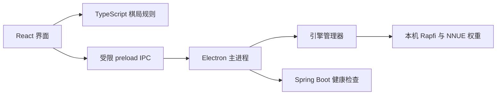

# 架构与数据边界

[返回项目首页](../README.md) · [开发与验证](development.md) · [Rapfi 引擎](rapfi.md)



棋局在前端内存中运行。人机落子和概率分析交给本机 Rapfi，Java 服务提供健康检查；当前不引入数据库，也不保存设置或棋谱。

## 目录

```text
src/             React 页面、音效、样式与模式设置
src/components/  展示组件、对话框、语言选择与页面元数据
src/hooks/       棋局分析请求与生命周期
src/i18n/        i18next 初始化、语言枚举与中英文资源
src/types/       渲染侧业务状态与错误码
src/game/        单人 / 双人棋局、悔棋与胜负判断
electron/        Electron 主进程和受限 preload 桥接
electron/engine/ Rapfi 生命周期、协议与配置
shared/          前端与主进程共用的类型和业务枚举
native/windows/  Windows Job Object 守护程序源码（macOS 无需守护程序）
config/          随引擎复制的版本匹配配置
resources/rapfi/ 本地引擎和权重（生成目录，Git 忽略）
backend/         Spring Boot 服务、配置与集成测试
scripts/         开发启动与进程管理
tests/           Playwright 端到端测试
tests-engine/    协议、真实模型与进程生命周期测试
public/          本地图标
docs/            开发文档、架构说明与 README 展示素材
rsbuild.config.ts React / Tailwind 构建、开发服务与代理
```

### 前端构建与国际化

React + TypeScript 负责界面，Rsbuild 使用 React 与 Tailwind CSS 插件构建。通用布局使用 Tailwind 工具类，设计变量集中在 `src/tailwind.css` 的 `@theme`；棋盘木纹、棋子与获胜连线动画保留专用 CSS。当前沿用原有基础重置，仅引入 Tailwind 的主题和工具层，避免 Preflight 改变原生弹窗与棋盘按钮的行为。

i18next / react-i18next 读取随应用打包的简体中文、英文资源，资源键具有 TypeScript 类型检查。语言选择与页面元数据组件独立维护展示语言；棋局规则、音效和分析请求不依赖语言状态。引擎返回稳定的状态 / 错误码，展示层翻译相应提示。切换语言不会清空棋子、分析历史或重新发起搜索。

开发时 Rsbuild 监听回环地址并代理 `/api`，Electron 通过 `GOMOKU_DEV_SERVER_URL` 加载开发页面。生产构建使用相对资源路径，Electron 直接加载 `dist/index.html`；字体与语言资源无需联网读取。

后端使用 Spring Boot 3.5.11、Spring MVC 和内嵌 Tomcat，Java 版本为 17；Spring Boot 与 Java 版本对齐参考项目 CampusSys。入口为 `GomokuApplication`，通过 Spring Boot Maven 插件打包为 `backend/target/gomoku-backend.jar`。当前仅提供健康检查，不读写用户数据，也不需要数据库或 Redis。双人棋局由 TypeScript 本地处理，本地 AI 分析由 Electron 管理 Rapfi 子进程完成。React 页面未直接暴露 Node.js 能力，Electron 启用上下文隔离、沙箱与不写磁盘缓存的内存会话。

中文字体由 npm 字体包提供，随应用本地构建，无需运行时从外网加载字体或图片。

### 后端分层约定

```text
backend/src/main/java/dev/yijian/gomoku/
├── GomokuApplication.java          应用启动入口与配置扫描
├── config/
│   └── ServiceProperties.java      服务元信息的类型化配置
├── controller/
│   └── HealthController.java       HTTP 路由与业务服务调用
├── dto/
│   └── ErrorResponse.java          API 错误响应对象
├── entity/
│   └── HealthStatus.java           服务健康状态业务对象
├── exception/
│   └── GlobalExceptionHandler.java 统一异常处理
├── filter/
│   └── ApiResponseFilter.java      API 通用响应头过滤器
├── mapper/
│   └── package-info.java           数据访问层预留与职责说明
├── service/
│   ├── HealthService.java          业务接口
│   └── impl/
│       └── HealthServiceImpl.java  业务实现
└── utils/
    └── ApplicationArgumentsUtils.java 启动参数校验工具
```

- 包名统一小写，类名使用大驼峰；Service 接口放在 `service`，实现类放在 `service.impl` 并以 `Impl` 结尾。Java 使用 4 个空格缩进，XML 使用 2 个空格，具体编辑器约定见 [`backend/.editorconfig`](../backend/.editorconfig)。
- Controller 调用 Service 接口，由 Spring 注入 `service.impl` 中的实现类；Controller 只处理路由和调用，业务状态由 Service 实现类构建，依赖使用构造器注入。
- `entity` 放业务对象，`dto` 放接口传输对象；目前的 `HealthStatus` 是不可变业务对象，不映射数据库表。错误响应继续使用 `error` 字段，健康检查继续使用 `status`、`service`、`version` 字段。
- `config` 放配置绑定和配置类，`exception` 放统一异常处理，`filter` 放 HTTP 过滤器，`utils` 只放无状态工具。
- `mapper` 当前仅保留包说明，没有 Mapper 实现或数据库依赖。未来明确需要持久化时，由 Service 实现调用 Mapper，Controller 不直接访问数据库。
- 测试放在 `backend/src/test/java` 对应包下；接口行为与配置绑定测试放在 `controller`，启动入口测试与启动类同包。

健康检查使用的服务标识和版本集中配置在 `application.yml` 的 `gomoku.service.name`、`gomoku.service.version`，也可通过标准 Spring Boot 命令行参数覆盖；默认接口响应与重构前一致。

## API 与数据

| 方法 | 路径          | 用途         |
| ---- | ------------- | ------------ |
| GET  | `/api/health` | 检查服务状态 |

原 `/api/preferences` 读写接口及 Java `--data-dir` 参数已移除。模式与音效只使用 React 内存状态，应用不使用 `localStorage`、`sessionStorage`、数据库或 JSON 文件持久化用户数据。

默认设置为简体中文、普通难度（棋逢对手）、执黑、音效开启。刷新页面或重启应用后恢复默认，棋局与历史记录也不会恢复。旧版本已生成的偏好文件及浏览器数据不再读取或更新，不自动删除。

构建产物、测试截图及 Electron 自身的运行文件不属于用户设置或棋局数据；测试输出仍写入已被 Git 忽略的目录。

完整代码编写规范见 [AGENT.md](../AGENT.md)。
